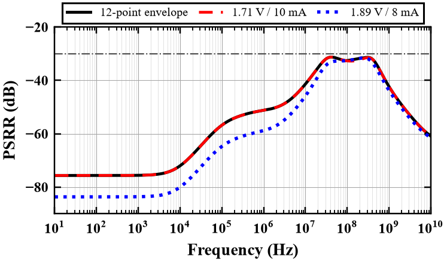

# NCM-LDO: neutralized current-mode LDO (180 nm)

Course project, **Analog CMOS VLSI Design**, IIIT Bangalore. Garaga Karthikeya (IMT2024073).

An on-chip LDO that turns a shared, noisy 1.8 V rail into a clean 1.4 V supply for a PLL.
- The pass transistor is a 100× current mirror of a reference device whose drain is held at Vout. This cancels the pass device's gm and gds ripple paths.
- A 1 pF capacitor injected at the reference drain cancels the Cgd path, which the mirror would otherwise multiply by 100.

📄 **Report:** [report/report.pdf](report/report.pdf) · 📊 **Design sheet:** [design_sheet/NCM_LDO_Design.xlsx](design_sheet/NCM_LDO_Design.xlsx) · 🔌 **LTspice schematic:** [design/NCM_LDO.asc](design/NCM_LDO.asc)



| Spec | Target | Result |
|---|---|---|
| Vout, 0–10 mA, 1.71–1.89 V | 1.4 V ±1 % | 1.3997–1.4067 V |
| Worst PSRR, 10 Hz–10 GHz (8–10 mA) | ≤ −30 dB | **−31.3 dB** |
| DC loop gain, 0–10 mA | — | 75–85 dB |
| Crossover at 10 mA | — | 21.4 MHz |
| Quiescent current | ≤ 300 µA | 289 µA |
| Total on-chip capacitance | ≤ 1 nF | 1.000 nF |
| Dropout at 10 mA | ≤ 300 mV | 25 mV |
| Phase margin, 0–10 mA | ≥ 45° | 48.9° min |
| Noise at 1 MHz | ≤ 20 nV/√Hz | 18.4 nV/√Hz |
| Load step 8↔10 mA, 10 ns | ±20 mV | ±17.0 mV |
| Start-up from 0 V (0.1–100 µs ramps, 18 cases) | starts | clean, no chatter, ≤ 1.407 V peak |

LTspice, typical models (course 180 nm, `models/models_292p.txt`), 27 °C, ideal reference and bias.
Start-up is verified with behavioral (compliant) bias generators. Corners, mismatch and a real reference/bias are **not** verified.

## Layout
| Folder | Contents |
|---|---|
| `design/` | `NCM_LDO.asc`: open it in LTspice and run it (`.ac` PSRR with a `.meas` of the worst case). Transistor sizes and DC operating point are printed on the sheet |
| `design_sheet/` | gm/Id design flow, with hand/techplot value, simulated value and error % for every step |
| `sim/` | Python + LTspice batch scripts; `design.py` is the single source of every value |
| `results/` | `specs.json`: every number in the report |
| `report/` | IEEE-style report (`report.tex`, circuitikz schematics, figures, tables) |
| `models/`, `techplots/` | Course-supplied 180 nm models and gm/Id techplots |

## Reproduce
Needs LTspice (set `LTSPICE_EXE` if it is not at `C:\Program Files\ADI\LTspice\LTspice.exe`), Python 3 with `numpy openpyxl matplotlib`, and a LaTeX install for the report.

```
cd sim
python spec_check.py          # full spec check -> results/specs.json
python make_figures.py        # report/figures
python make_tables.py         # report/tables
python make_design_sheet.py   # design_sheet/NCM_LDO_Design.xlsx
python make_schematic.py      # design/NCM_LDO.asc
python check_schematic.py     # LTspice netlist of the .asc == the simulated circuit
cd ../report && pdflatex report.tex && pdflatex report.tex
```
